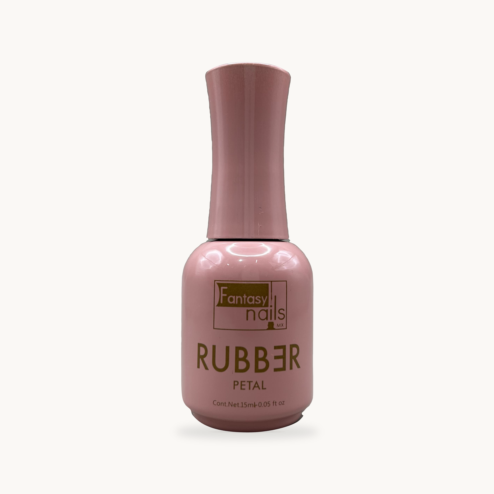
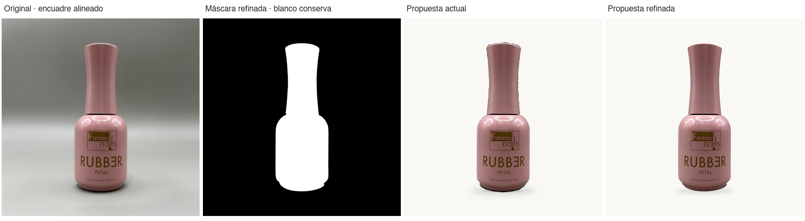
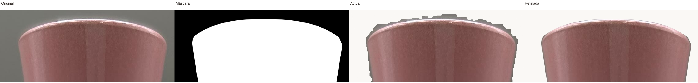
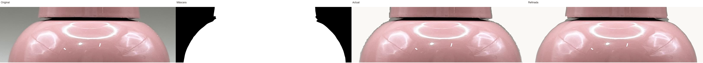
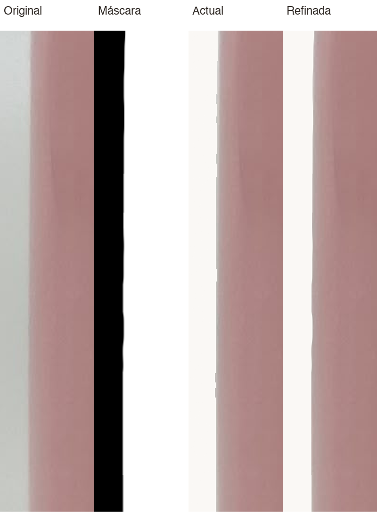
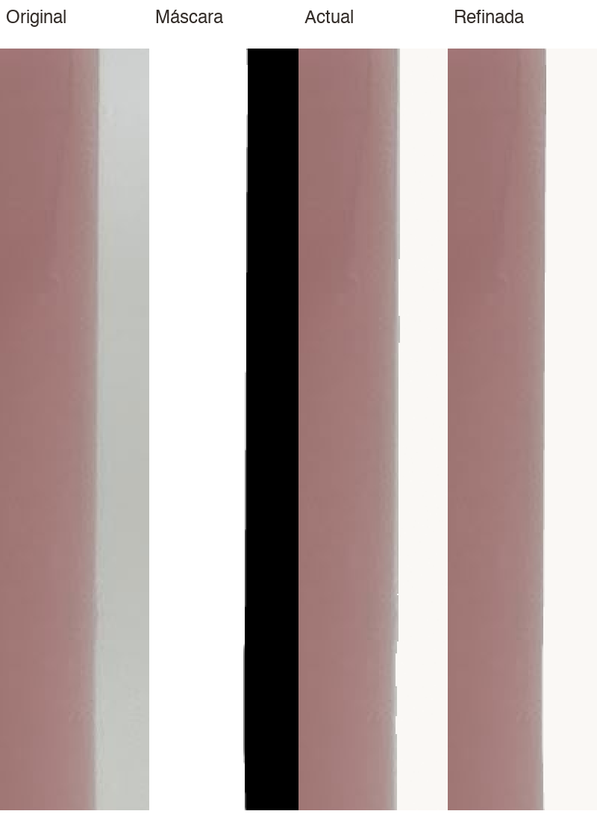
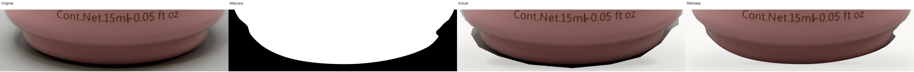
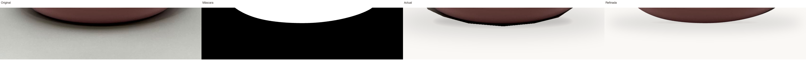

> **Candidata vigente para revisión puntual:** [17141 · corrección R2](correccion-puntual-r2/README.md). Incluye únicamente los dos ajustes solicitados tras la auditoría de Dirección. Los archivos siguientes se conservan como evidencia de la versión anterior; ninguna versión está autorizada para publicación.

# SICARÚ · Revisión visual exclusiva · SKU 17141

**PENDIENTE DE APROBACIÓN VISUAL. NO AUTORIZADO PARA PRODUCCIÓN NI USO COMERCIAL.**

Dirección NO aprueba publicar los originales ni el paquete completo de seis propuestas. Este piloto refina exclusivamente **17141 · Gel Rubber Petal** mediante máscaras y composición fotográfica convencional, sin IA generativa. Los otros cinco SKU mantienen sus propuestas anteriores. No extender el tratamiento hasta aprobar el piloto. El PR backend #7 sigue independiente.

## Acceso para auditoría desde ChatGPT

Esta carpeta versionada contiene los archivos de revisión. No está bajo public/, no está importada por el sitio y no modifica las fotografías de fichas o tarjetas. La disponibilidad para ChatGPT depende del acceso del usuario/conector al repositorio; no se cambiaron su visibilidad ni sus permisos. Si una sesión no puede abrir GitHub, adjuntar los archivos a esa sesión; no interpretar una falta de acceso como aprobación o ausencia de evidencia.

## Propuesta refinada

[PNG original de la propuesta, 2823 × 2823](17141-catalogo-refinada.png)

## Comparación de cuatro vistas

Orden: **original alineado · máscara refinada · propuesta anterior · propuesta refinada**.

## Informe y evidencias

- [Informe de revisión y zonas pendientes](REVISION_PILOTO.md).
- [Verificación de dimensiones, hashes y fidelidad RGB](verificacion-piloto.json).
- [Fotografía original intacta, sólo respaldo](17141-original-respaldo.jpeg).
- [Propuesta anterior intacta](17141-propuesta-anterior.png).
- [Máscara refinada](17141-mascara-refinada.png) y [capa original RGBA](17141-producto-original-con-mascara.png).
- [Sombra separada](17141-sombra.png).
- [Script convencional reproducible](herramientas/refinar.py), requiere Pillow, NumPy y OpenCV en entorno separado; no cambia dependencias de la aplicación.

## Bordes críticos ampliados

Abrir cada archivo a tamaño nativo: las láminas contienen recortes al 200%, pero GitHub puede reducir la vista. Las cuatro columnas conservan siempre el mismo orden.

### Tapa

[Ver ampliación completa](ampliaciones/17141-tapa-200pct.png)

### Hombros y unión del cuello

[Ver ampliación completa](ampliaciones/17141-hombros-200pct.png)

### Lateral izquierdo

[Ver ampliación completa](ampliaciones/17141-lateral-izquierdo-200pct.png)

### Lateral derecho

[Ver ampliación completa](ampliaciones/17141-lateral-derecho-200pct.png)

### Base

[Ver ampliación completa](ampliaciones/17141-base-200pct.png)

### Sombra de contacto

[Ver ampliación completa](ampliaciones/17141-sombra-200pct.png)

## Límites de la verificación

Los RGB de la capa fuente son idénticos al original. Los píxeles opacos de la composición también coinciden; el borde con alfa parcial se mezcla con el nuevo fondo y no se declara idéntico en la imagen aplanada. El control numérico no sustituye la aprobación humana del recorte.

Revisar especialmente los extremos de la unión tapa/cuello y la base derecha. El filo luminoso superior es un reflejo original conservado. La nota V52007133 sigue pendiente de cotejo directo. Esta entrega no autoriza precios, existencias, altas Medusa, publicación, checkout o publicidad.
