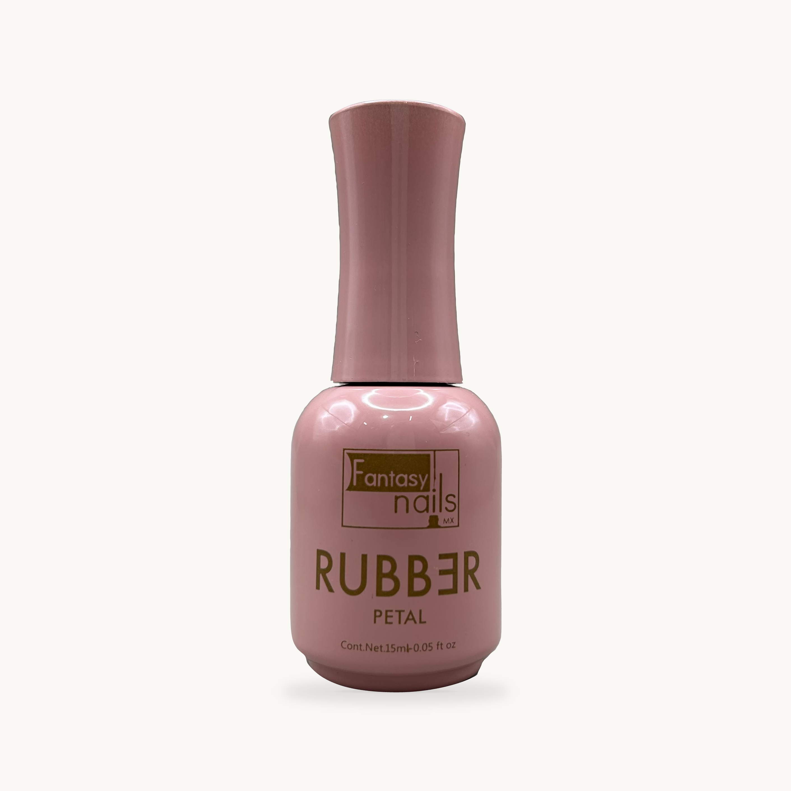
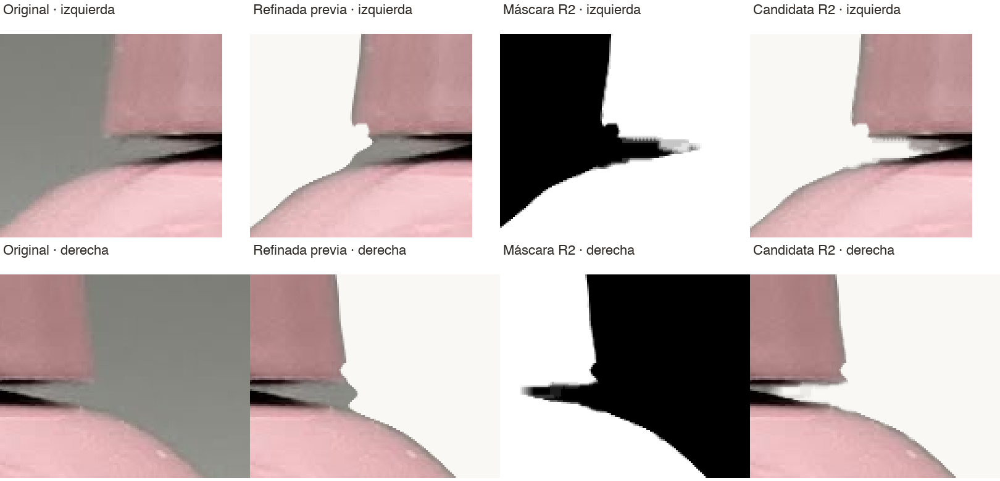
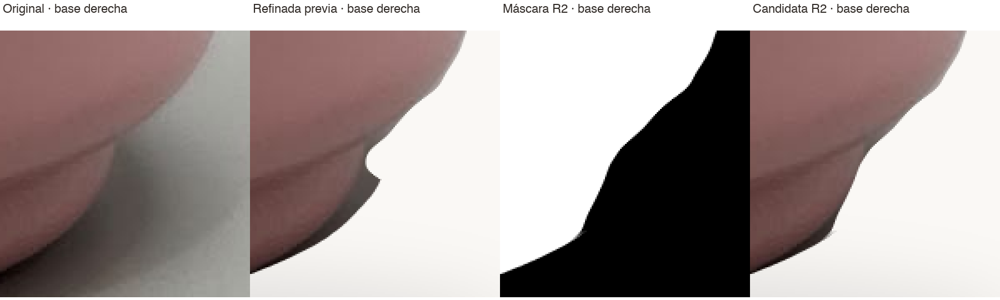

# 17141 · Candidata R2 · corrección puntual solicitada por Dirección

**Pendiente de aprobación visual. No autorizada para publicación ni uso comercial.**

Esta revisión corresponde exclusivamente a dos ajustes aprobados para trabajar: los extremos izquierdo/derecho de la unión tapa-cuello y la pequeña irregularidad de la base derecha. La versión anterior se conserva sin cambios en la carpeta superior.

## Archivos de auditoría

- [Versión final candidata R2](17141-catalogo-candidata-r2.png), PNG RGB sin pérdida, **2823 × 2823**.
- [Comparación de ambos extremos tapa/cuello](17141-union-tapa-cuello-comparativa-r2.png).
- [Comparación de la base derecha](17141-base-derecha-comparativa-r2.png).
- [Máscara candidata en coordenadas del original](17141-mascara-candidata-r2.png).
- [Resultados técnicos](verificacion-r2.json) y [procedimiento reproducible](herramientas/correccion.py).

## Dos ampliaciones actualizadas

Las ampliaciones son al **300%** con vecino más próximo. GitHub puede reducirlas: abrir a resolución completa para inspeccionar píxeles. Columnas: **original · refinada previa · máscara R2 · candidata R2**. En la lámina de la unión, arriba está el extremo izquierdo y abajo el derecho.

## Qué se modificó

1. Se redujo exclusivamente la transparencia de fondo neutro atrapado en los extremos del cuello mediante máscara local y medición cromática/lumínica convencional. Se protegieron los píxeles negros opacos de la unión y las zonas de color definido. No se pintó, clonó, rellenó ni reconstruyó el cuello.
2. Se retrazó localmente la salida derecha de la base sobre la fotografía original para retirar la saliente artificial de la máscara previa. El ajuste está limitado a esa zona y no modifica el resto de la base.

Sólo se modificó alfa. Los píxeles de color originales se usan tal como están; el borde con transparencia parcial se mezcla con el fondo existente. No se aplica IA generativa ni corrección de exposición, color, etiqueta, iluminación, reflejos o defectos reales.

## Comprobaciones

- **1,699 píxeles de salida diferentes; 0 diferencias fuera de las tres regiones autorizadas.** Las cajas exactas en coordenadas de fuente están en el JSON.
- **5,677 píxeles oscuros opacos de la unión completa comprobados: idénticos a la refinada previa.** Incluye el tramo central que no se editó. Los bordes de transición con alfa parcial no se declaran RGB idénticos en la composición.
- Misma escala nativa 1:1, posición/traslación (-5,-475), lienzo 2823×2823 y fondo #FAF8F5.
- Misma sombra, reutilizada del archivo existente byte a byte; no se recalculó ni se retocó. Fuera de las regiones también se comprueba igualdad de la imagen aplanada, incluida la sombra visible.
- Original y refinada previa intactos y trazables por SHA-256 en el JSON. Se conservan los archivos de auditoría anteriores; las otras cinco propuestas no se editan.
- Se revisaron visualmente ambas láminas comparativas. El control técnico no sustituye la aprobación visual de Dirección; no se declara autorización comercial.

No se modificaron public/, src/, backend #7, registros Medusa, precios o existencias. No se publica en producción ni se fusiona el PR #30. La aprobación de esta candidata debe ser expresa antes de extender el tratamiento a los otros SKU o sustituir activos comerciales.
