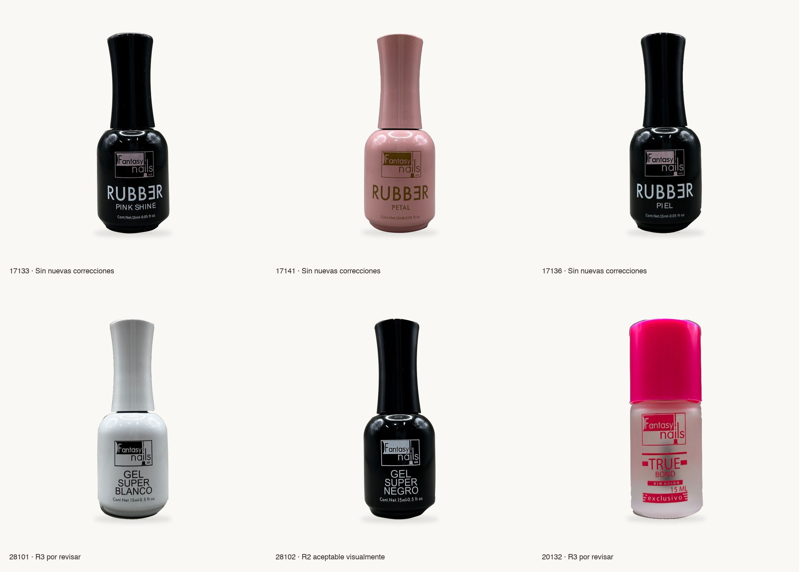
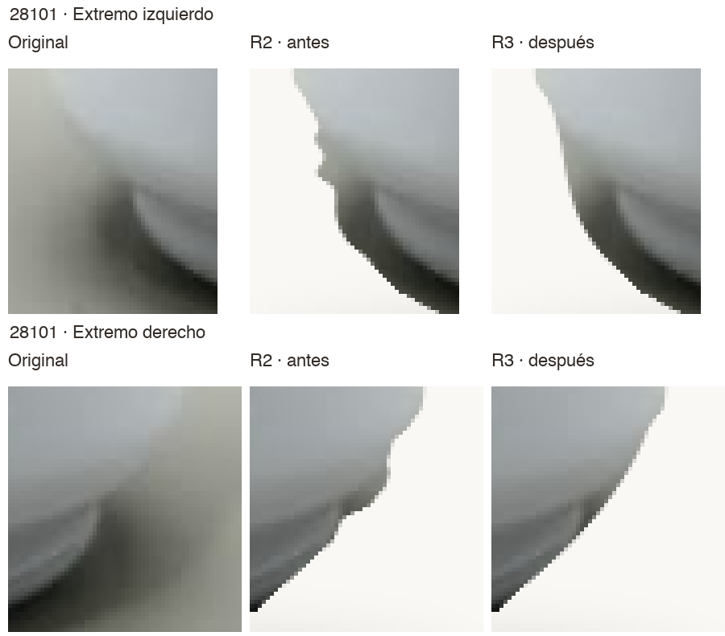
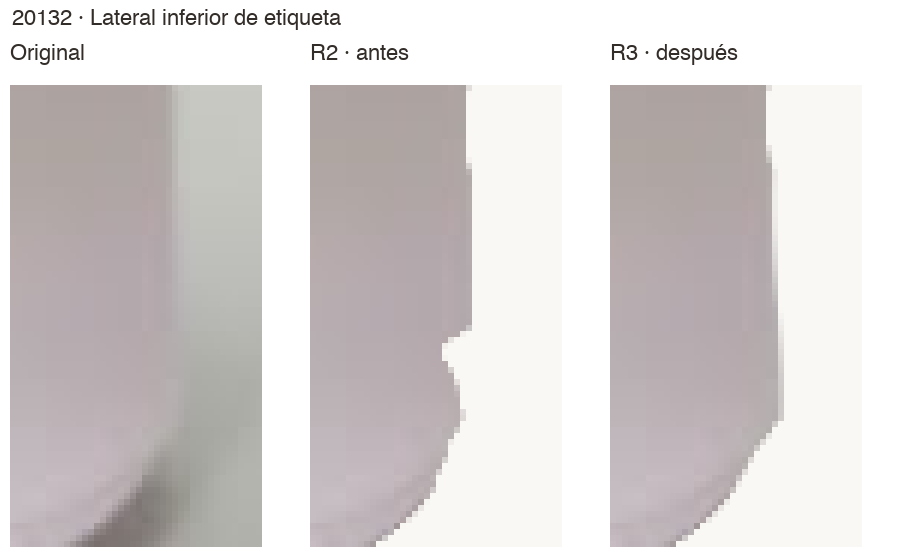

# Últimas correcciones puntuales · Blanco y TrueBond · candidatas R3

**Sólo revisión del PR #30. Aprobación visual definitiva y autorización para publicar son decisiones separadas. No autorizado para producción ni sustitución de activos comerciales.**

| SKU | Candidata final propuesta | Ampliación específica |
|---|---|---|
| 28101 · Gel Super Blanco | [PNG R3 · 914×914](28101-candidata-final-r3.png) | [Ambos extremos inferiores · original / R2 / R3](28101-ampliaciones-original-r2-r3.png) |
| 20132 · TrueBond sin ácido | [PNG R3 · 883×883](20132-candidata-final-r3.png) | [Lateral derecho junto a parte baja de etiqueta · original / R2 / R3](20132-ampliaciones-original-r2-r3.png) |

## Vista conjunta actualizada

No se crearon nuevas versiones de los otros cuatro productos. La lámina sólo lee sus archivos originales de revisión y los reduce en celdas iguales para comparar coherencia visual. Los másteres no se escalan ni se sobrescriben. Los rótulos aparecen sólo en esta lámina, nunca en los productos individuales.

[Abrir vista conjunta completa](seis-productos-vista-conjunta-actualizada.png).

Las versiones seleccionadas son: 17133 y 17136 del lote 1f9c777; 17141 Petal R2; **28102 Negro R2 de bbc683b, conservada exactamente**; y las dos candidatas R3 de esta carpeta. Las huellas de los cuatro archivos intocables están en la verificación. “Sin nuevas correcciones” y “aceptable visualmente” describen la auditoría recibida y no conceden permiso de publicación.

## 28101 · Extremos inferiores

Se regularizó únicamente la continuidad del contorno de los dos extremos inferiores, contrastando el original con la máscara visible de R2. Se retiraron los dientes locales de cobertura, especialmente a la izquierda, sin cambiar el resto del envase. No se alteraron cuello/tapa, etiqueta, color, iluminación o reflejos. Escala nativa, traslación (-22,-175), dimensiones 914×914, fondo #FAF8F5 y sombra de R2 intactos.

## 20132 · Lateral derecho inferior de etiqueta

Se corrigió exclusivamente la entrada y salida artificial de máscara del lateral derecho junto a la parte baja de la etiqueta. La frontera se ajustó al borde óptico medido en el original; se recuperaron píxeles reales de ese contorno que R2 había omitido. No se reconstruyó ni redibujó material. La tapa R2 y la corrección previa de base se conservan fuera de la zona indicada.

El interior del cuerpo translúcido y la impresión permanecen idénticos a R2: **0 diferencias en la región fuente (380,600)–(585,915)**. Su influencia gris se conserva; no se recolorea, blanquea ni reemplaza el fondo transmitido a través del frasco. Las modificaciones son únicamente de cobertura en el borde exterior. Mismas dimensiones 883×883, escala nativa, traslación (-42,-182), fondo y sombra.

## Verificaciones

- Se reabrieron las dos candidatas y se compararon con R2: **28101, 160 píxeles ajustados; 20132, 144 píxeles ajustados; cero diferencias fuera de las zonas documentadas**.
- Los píxeles corregidos se explican exclusivamente mediante composición del RGB original y el mismo fondo/sombra. No se pinta ni retoca el RGB del producto. El borde con alfa parcial mezcla original y fondo; no se afirma igualdad RGB del borde aplanado.
- Regiones protegidas de interior/etiqueta: 0 diferencias. Sombras existentes reutilizadas sin recalcular ni modificar. Originales y versiones anteriores permanecen intactos.
- Cuatro archivos conservados por SHA-256: 17133, 17141, 17136 y 28102. El negro usa exactamente el archivo R2 aceptable visualmente, no el primer lote ni una regeneración.
- Sin IA generativa, cambio de escala o proporciones, recoloración, retoque de luz ni reconstrucción. Las ampliaciones de 500%/600% usan vecino más próximo para mostrar los píxeles; GitHub puede reducir la vista. Abrir a resolución completa para inspeccionar.
- [Resultados y regiones de control](verificacion.json); [procedimiento reproducible](herramientas/refinar.py). La comprobación de píxeles no sustituye la decisión visual de Dirección.

Los cinco PNG nuevos (dos candidatas, dos ampliaciones, una vista conjunta) están sólo en esta carpeta documental. No se modificaron otros activos, Medusa, precios, inventarios, pagos o dependencias del sitio. No se fusiona el PR ni se despliega producción. No se ejecuta build/lint de la aplicación porque no cambia su código; sí se ejecutaron las verificaciones de composición, alcance, hashes y enlaces.
