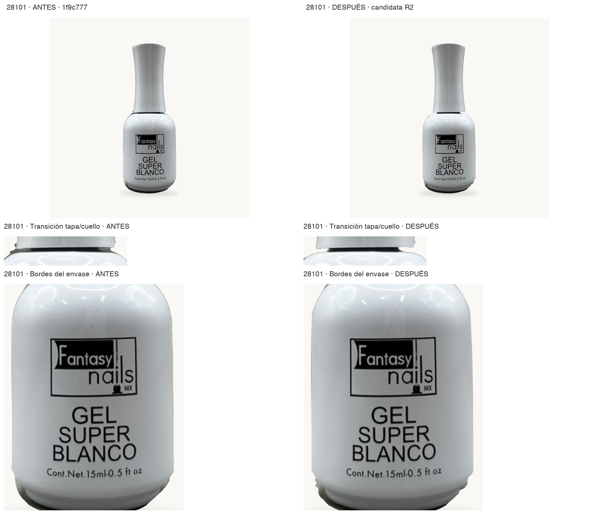
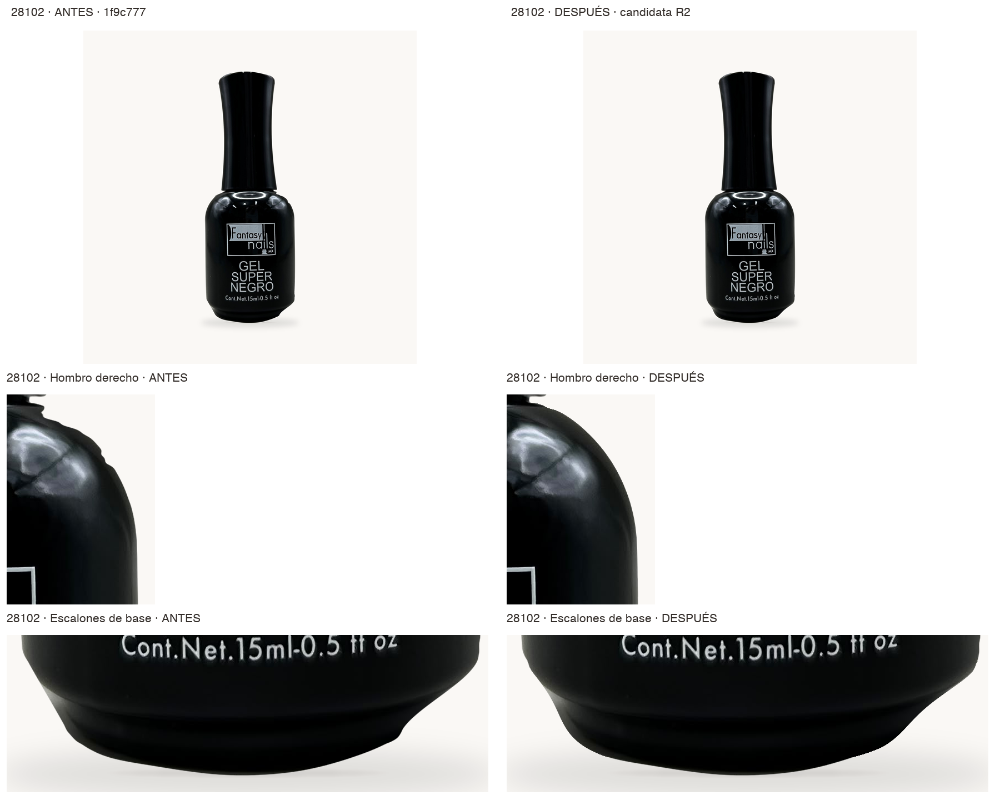
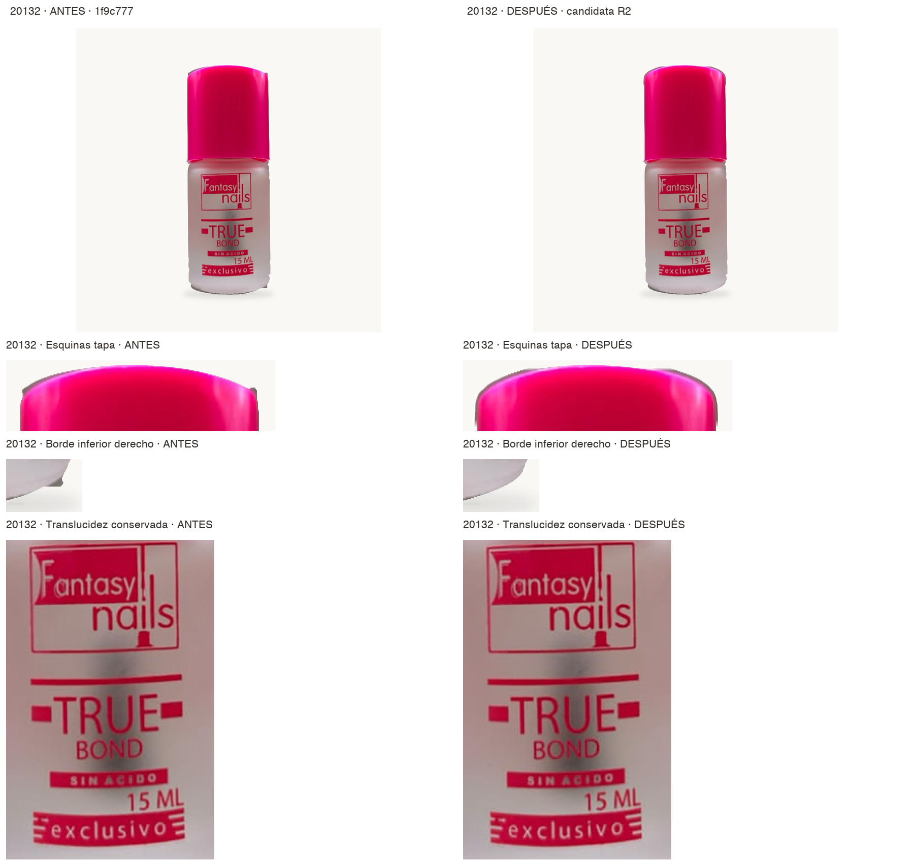

# Correcciones puntuales · 28101, 28102 y 20132 · R2

**Tres candidatas para revisión. La aprobación comercial de las seis fotografías sigue pendiente de Dirección SICARÚ. No autorizado para producción.**

Se conserva íntegra la entrega del commit 1f9c777. Sólo se añaden tres imágenes refinadas y tres comparaciones antes/después, más este registro técnico. No se toca 17133, 17141 Petal R2 ni 17136; tampoco se genera otra vista conjunta que pudiera confundirse con una aprobación del paquete.

| SKU | Versión refinada | Antes/después | Dimensiones conservadas |
|---|---|---|---|
| 28101 · Gel Super Blanco | [PNG](28101-refinada-r2.png) | [Comparación](28101-comparacion-antes-despues.png) | 914×914 |
| 28102 · Gel Super Negro | [PNG](28102-refinada-r2.png) | [Comparación](28102-comparacion-antes-despues.png) | 3110×3110 |
| 20132 · TrueBond sin ácido | [PNG](20132-refinada-r2.png) | [Comparación](20132-comparacion-antes-despues.png) | 883×883 |

## 28101 · Blanco

Se redujo el residuo neutro exterior en los dos extremos tapa/cuello y se ajustó el límite de los bordes del envase midiendo su transición óptica en el original. La unión negra central, los reflejos blancos y la iluminación gris/azulada del material permanecen intactos. No se neutraliza el color del plástico ni se pinta blanco sobre él. En la fuente de 960×1280 hay transiciones desenfocadas de producto/fondo: se conserva la información del producto antes que borrar una iluminación real; no se afirma una descontaminación cromática del material.

## 28102 · Negro

Se reajustó el hombro derecho a su borde medido en la fotografía fuente. Se recuperaron píxeles originales de esa silueta que la máscara anterior había omitido; no se dibujó ni reconstruyó el plástico. Se regularizaron por separado las transiciones exteriores de los dos escalones de la base, conservando las bandas, textura y reflejos del envase original. El resto del producto no se modifica.

## 20132 · TrueBond: dos evaluaciones distintas

**Contorno:** se ajustaron las esquinas del contorno superior de la tapa a la transición rosa/fondo medida sobre el original, incluida la recuperación de borde rosa original omitido por la máscara previa. Se corrigió la saliente inferior derecha usando su límite óptico real. El producto no se escala ni se desplaza; sólo cambia su cobertura de máscara.

**Translucidez:** el gris visible a través del cuerpo se conserva. El cuerpo y la etiqueta en la región fuente (380,600)–(585,915) presentan **0 diferencias de píxel frente a la candidata anterior**. La fotografía disponible no permite separar ese gris transmitido de la apariencia real del material sin alterar sus píxeles. No se aplicó sustitución de fondo dentro del frasco, recoloración, blanqueamiento ni reconstrucción. Resolverlo exigiría una nueva toma fotográfica controlada del producto real, no un reemplazo automático en esta edición. La limitación queda documentada y la comparación muestra el cuerpo por separado.

## Controles y límites

- Sólo máscaras convencionales y composición de los RGB de cada original. Sin IA generativa, pintura, clonado ni retoque de etiquetas, colores, luz, materiales o defectos reales.
- Mismas dimensiones, proporciones, escala nativa 1:1, traslación y fondo #FAF8F5. Las tres sombras existentes se reutilizan byte a byte; no se recalcularon ni retocaron.
- **0 cambios fuera de las cajas de corrección documentadas**. Reapertura y comparación independiente de cada PNG. Se comprueba igualdad de las regiones protegidas de reflejos, etiquetas y, en el blanco, de la unión negra central.
- Dentro de los píxeles opacos modificados, RGB idénticos al original. La transición de borde con alfa parcial mezcla el RGB original con el fondo; no se declara idéntico el borde aplanado ni se usa ese control como sustituto de la revisión visual.
- Las tres comparaciones muestran la candidata anterior de 1f9c777 y la refinada, con encuadre idéntico. Las vistas completas se reducen sólo en la lámina; los detalles de las fuentes 960×1280 se amplían al 200%, y los de 3024×4032 se muestran a escala nativa. GitHub puede reducir la lámina: abrir la imagen completa.
- [Verificaciones, regiones protegidas y SHA-256](verificacion.json). [Procedimiento reproducible](herramientas/refinar.py). No se cambian dependencias del sitio ni se ejecutan builds de la aplicación: es exclusivamente una entrega documental/fotográfica.

- **28101: 1,138 píxeles de salida ajustados**, todos dentro de las regiones autorizadas; sombra y regiones protegidas comprobadas sin diferencias.
- **28102: 3,748 píxeles de salida ajustados**, todos dentro de las regiones autorizadas; sombra y regiones protegidas comprobadas sin diferencias.
- **20132: 765 píxeles de salida ajustados**, todos dentro de las regiones autorizadas; sombra y regiones protegidas comprobadas sin diferencias.

Se verificaron también las firmas de las imágenes 17133, 17136 y 17141 R2: permanecen intactas. No se escriben archivos en public/, no se sustituyen activos comerciales, no se modifica Medusa y no se fusiona ni despliega a producción. Esta entrega no marca ninguna fotografía como comercialmente aprobada.
