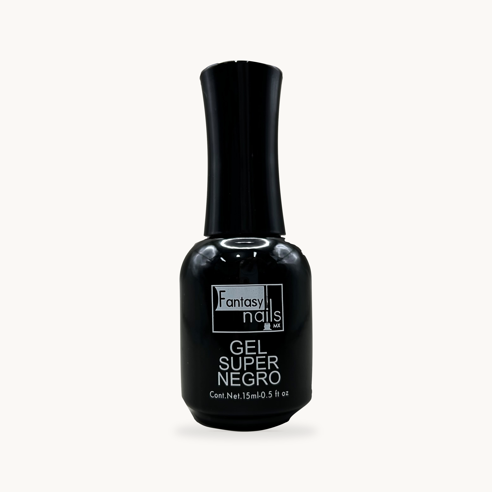
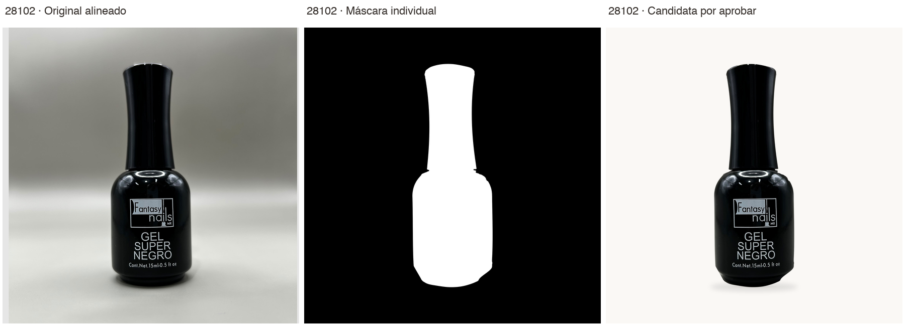
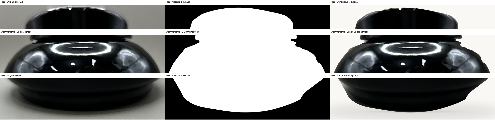

# 28102 · Gel Super Negro · candidata individual

**Pendiente de revisión y aprobación individual. No autorizada para publicación ni uso comercial.**

Referencia de composición: Petal 17141 R2 aceptada por Dirección, sin modificar su archivo ni reutilizar su contorno. Esta máscara está trazada y ajustada sobre la fotografía original de 28102.

- [Candidata PNG · 3110×3110](28102-catalogo-candidata.png).
- [Original intacto · 3024×4032](28102-original-respaldo.jpeg).
- [Comparación original / máscara / candidata](28102-comparacion.png).
- [Bordes críticos al 200%: tapa, unión/hombros y base](28102-bordes-criticos-200pct.png).
- [Máscara](28102-mascara.png), [capa original RGBA](28102-producto-original-mascarado.png) y [sombra separada](28102-sombra.png).
- [Verificación técnica y hashes](verificacion.json).

## Fidelidad y composición

Fondo #FAF8F5, formato cuadrado, producto a escala nativa 1:1 por traslación entera, sin corrección de color/luz ni reconstrucción generativa. Altura visible: 75.50% del lienzo. Márgenes izquierda/arriba/derecha/abajo: 1134/381/1134/381 píxeles. La anchura sigue siendo la auténtica de la fotografía, no se estira para igualarla a otro envase.

RGB de toda la capa fuente conservados sin alteración; 0 diferencias en el interior opaco de la composición. La transparencia parcial del borde se compone con el nuevo fondo; sus RGB aplanados no se afirman idénticos. La verificación independiente reabre archivos y recompone la candidata desde original, máscara y sombra: resultado exacto. Esto no sustituye la inspección humana de la precisión del recorte.

## Revisión individual necesaria

Revisar ambos extremos de la unión tapa/cuello, la transición del hombro derecho y los dos escalones laterales de la base. Los destellos claros del filo superior pertenecen al original y se conservan.

Decisión de Dirección: aprobar visualmente / solicitar corrección puntual / rechazar: __________

La decisión no autoriza publicación, sustitución de activos comerciales ni altas en Medusa. [Volver al conjunto](../README.md).
