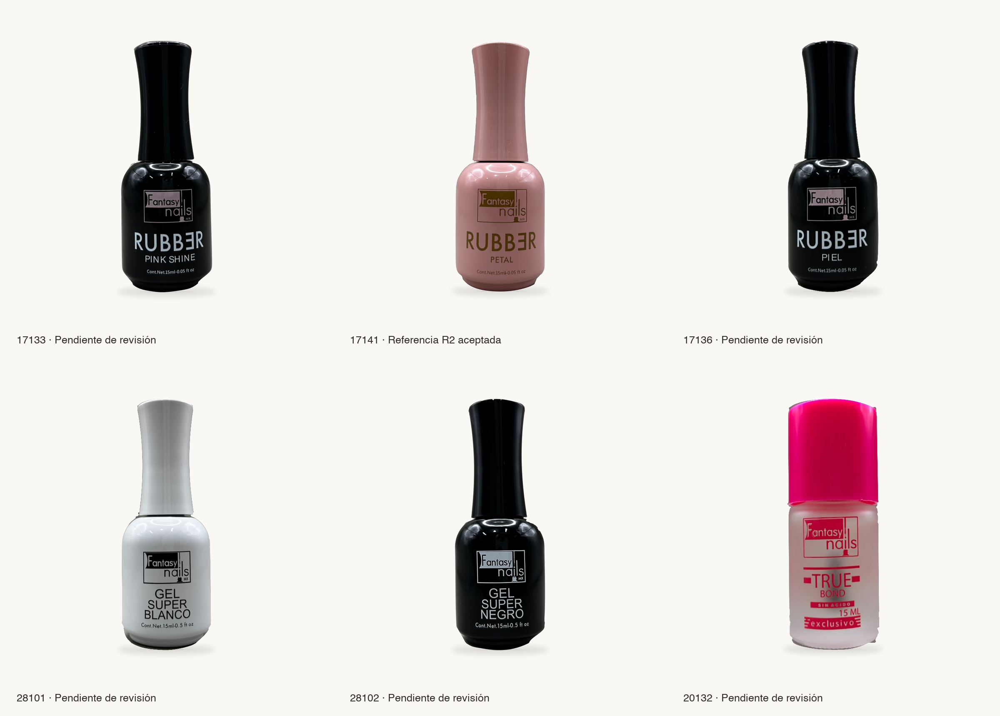

# Fantasy Nails · cinco candidatas tras aceptación del piloto Petal R2

**Sólo revisión del PR #30. No autorizado para publicación ni sustitución de activos comerciales.**

Dirección aceptó Petal 17141 R2 como referencia visual. Su archivo y toda su carpeta permanecen intactos. Las nuevas candidatas 17133, 17136, 28101, 28102 y 20132 requieren decisión individual; la aceptación de Petal no se transmite a ellas.

## Vista comparativa de los seis productos

Seis celdas iguales, fondo común y rótulo de estado fuera de los archivos de producto. Se mantiene el archivo Petal R2, sólo reducido en esta lámina de revisión; no se crea una nueva versión del producto Petal. La reducción de visualización no reemplaza los másteres nativos.

[Abrir la lámina completa](seis-sku-comparativa.png).

## Decisiones individuales y geometría

| SKU | Producto | Máster PNG | Altura relativa | Márgenes I/A/D/B (px) | Estado |
|---|---|---|---|---|---|
| [17133](17133/README.md) | Gel Rubber Pink Shine | [2897×2897](17133/17133-catalogo-candidata.png) | 75.49% | 1052/355/1053/355 | Pendiente individual |
| [17136](17136/README.md) | Gel Rubber Piel | [965×965](17136/17136-catalogo-candidata.png) | 75.44% | 351/118/352/119 | Pendiente individual |
| [28101](28101/README.md) | Gel Super Blanco | [914×914](28101/28101-catalogo-candidata.png) | 75.49% | 334/112/335/112 | Pendiente individual |
| [28102](28102/README.md) | Gel Super Negro | [3110×3110](28102/28102-catalogo-candidata.png) | 75.50% | 1134/381/1134/381 | Pendiente individual |
| [20132](20132/README.md) | TrueBond sin ácido | [883×883](20132/20132-catalogo-candidata.png) | 75.42% | 320/108/320/109 | Pendiente individual |
| [17141 · Petal R2](../17141/correccion-puntual-r2/README.md) | Referencia intacta | [2823×2823](../17141/correccion-puntual-r2/17141-catalogo-candidata-r2.png) | 74.96% | 1035/355/1032/352 | Aceptada como referencia visual; sin publicación |

Las nuevas alturas ocupan aproximadamente 75,5% del lienzo; Petal ocupa 74,96%. La diferencia es inferior a 0,6 puntos porcentuales, sin tocar Petal. El producto se centra por su propia silueta, con márgenes verticales y horizontales equilibrados a ±1 píxel en las nuevas candidatas. Las anchuras son diferentes por la forma real del envase: no se estiraron para igualarlas. La lámina compara tamaño visual, no dimensiones físicas en milímetros, que no se deducen de fotografías tomadas a distancias distintas.

Los tres originales de 960×1280 generan másteres más pequeños que los de 3024×4032. No se interpolaron ni inventaron detalles para alcanzar una dimensión común. La uniformidad del catálogo se evalúa a igual tamaño de celda en la lámina.

## Estándar aplicado y límites

- Fondo principal #FAF8F5 limpio y constante; sin elementos decorativos, textos o logos añadidos en los másteres. No hizo falta fondo alternativo.
- Cinco contornos distintos trazados manualmente sobre sus respectivas fotografías, con medición óptica local, regularización de máscara y antialias subpíxel. No se copia la máscara de Petal. Se conserva el interior del envase, sus etiquetas y reflejos.
- Sombra discreta con las mismas proporciones y niveles de composición del piloto, ajustada a la escala nativa y huella de cada envase. La sombra original de Petal no se toca.
- Sin generación, reconstrucción, clonado, retoque de color, material, iluminación o defectos reales. RGB de los productos originales intactos en capas RGBA y PNG sin pérdida. Sólo la máscara y el nuevo fondo/sombra forman la composición.
- En el borde con alfa parcial, el RGB compuesto se mezcla con el fondo: no se afirma igualdad de esos píxeles aplanados. La igualdad del interior opaco y de los RGB de las capas fuente está verificada. No equivale a certificar que una máscara sea visualmente perfecta.

## Zonas que requieren revisión individual

- **17133:** Revisar a tamaño nativo el reflejo del filo superior, los dos extremos de unión tapa/cuello (puede quedar una transición gris puntual) y los escalones de la base. Los arañazos, fibras y reflejos reales no se limpiaron.
- **17136:** Original de 960×1280: revisar escalonado residual, unión del cuello y contorno de la base, especialmente el lado derecho. No se inventó detalle ni se amplió el máster. Las marcas y la luz gris de los reflejos se conservan.
- **28102:** Revisar ambos extremos de la unión tapa/cuello, la transición del hombro derecho y los dos escalones laterales de la base. Los destellos claros del filo superior pertenecen al original y se conservan.
- **28101:** Original de 960×1280: el envase blanco conserva la iluminación gris/azulada real. Revisar el ribete de la tapa, los extremos del cuello y el contorno de la base: en el cuello puede persistir una franja gris conservadora por el bajo contraste con el fondo original.
- **20132:** Original de 960×1280. El gris visible a través del frasco translúcido se mantiene para no alterar los píxeles reales. Revisar pequeños remanentes/irregularidades en las esquinas superiores de la tapa, la unión tapa/frasco y la esquina de base derecha; no se declara que esas zonas estén visualmente aprobadas.

No se ocultan estas zonas ni se dan las cinco imágenes por aprobadas. Si Dirección identifica un recorte que invade producto o un remanente de fondo, la corrección deberá ser puntual sobre la máscara del SKU correspondiente.

## Evidencia y controles realizados

- [Verificación del lote](verificacion-lote.json): cinco originales cotejados contra el manifiesto existente, cinco capas RGB idénticas y cinco recomposiciones independientes exactas; dimensiones y márgenes registrados.
- El archivo Petal R2 mantiene SHA-256 `166df5915a623010dfaf6574e4df1dac2b871f77cf5b022f3683c27bb0c201a7`. No se modificó ningún archivo de su carpeta.
- Cada subcarpeta contiene original de respaldo, candidata, máscara, capa RGBA, sombra, comparación, ampliación y verificación. [Procedimiento convencional reproducible](herramientas/preparar.py).
- Se inspeccionaron visualmente las cinco comparaciones, las cinco láminas de bordes y la vista conjunta. Las láminas al 200% pueden verse reducidas por GitHub; abrir a tamaño completo para inspección nativa.
- No se ejecutaron lint/build de la aplicación porque no se cambia código del sitio ni sus dependencias. Sí se ejecutaron los controles de integridad, píxeles, composición y enlaces de documentación.

Todo el material nuevo vive exclusivamente en docs/catalog/revision-visual-fantasy-nails/, fuera de public/ y sin importación por el sitio. Sin cambios en Medusa, backend #7, precios, inventarios o checkout. No se fusiona el PR #30 ni se despliega producción.
