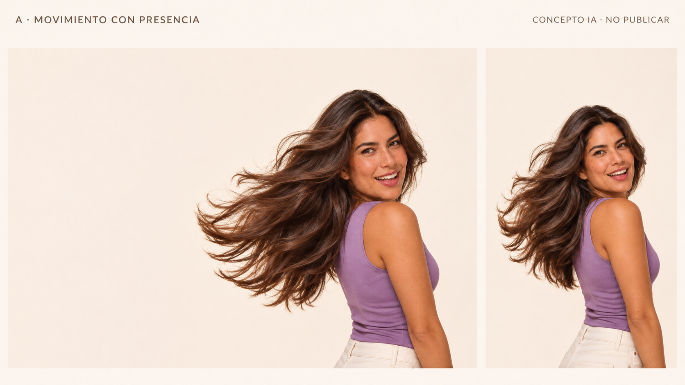
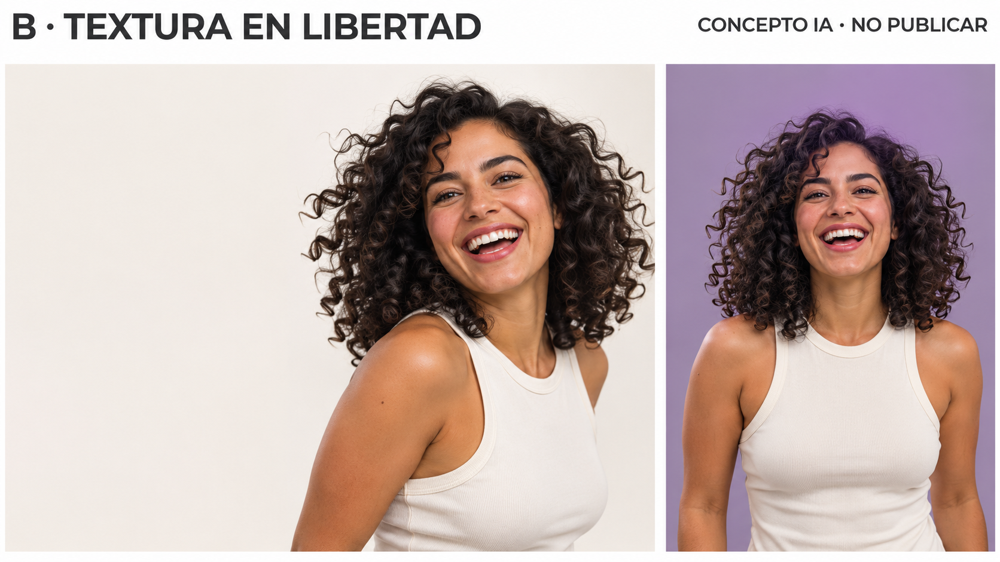

# SICARÚ · Dirección fotográfica V2 para evaluación

24 de noviembre de 2026. **La propietaria aprueba la simplificación estructural como base de trabajo; no aprueba todavía fotografía, diseño final ni publicación.** Ninguna propuesta se integró al código del banner. La línea técnica del catálogo y el mensaje de envíos están en el PR #43, separados de este trabajo.

## Cambio de intención

La propuesta anterior aportaba presencia humana, pero el gesto y el cabello podían leerse como un retrato estático. Esta ronda explora movimiento visible, expresión viva y textura protagonista. No se intenta compensar una foto débil con gradientes, aros, adornos o empaques generados. Los productos de las categorías aprobadas conservan su rol multimarca; no entran en estas fotografías conceptuales.

Las imágenes son **conceptos IA** con personas ficticias. No prueban una nacionalidad, una sesión real, fidelidad documental ni derechos de una fotografía contratada. Ninguna usa como referencia la foto rechazada del repositorio ni incluye productos/empaques. No se presentan como fotografía final ni assets listos para publicación.

## A · Movimiento con presencia

- **Idea:** cabello largo en un giro amplio, dirección diagonal y sonrisa segura. La prenda lavanda conecta con la paleta sin teñir piel ni cabello.
- **Potencia comercial:** la silueta del movimiento actúa como imagen reconocible; el mensaje dispone de su propio espacio limpio. El cabello aporta escala, volumen y dinamismo.
- **Integración a estudiar:** protagonista a la derecha en escritorio y texto a la izquierda; foto vertical propia para móvil, sin texto encima del cabello. Mantener la altura móvil acotada mediante una toma elegida para ese formato.
- **Revisar:** que el giro no parezca ventilador excesivo, que las hebras no se conviertan en una masa uniforme y que la sonrisa siga resultando cercana. No aprobar un encuadre que corte coronilla o puntas.

## B · Textura en libertad

- **Idea:** rizo natural, rebote y expresión espontánea; energía cercana de una persona que se mueve hacia cámara. El volumen del rizo crea una silueta distinta de la publicidad capilar uniforme.
- **Potencia comercial:** conexión humana rápida, textura con presencia y mayor variedad de belleza. La superficie lavanda es un fondo de campaña funcional, no un filtro morado ni un adorno.
- **Integración a estudiar:** fondo marfil en escritorio y variante lavanda en el encuadre vertical. La toma de fondo lavanda debe compararse con las categorías para evitar exceso de morado; no cambia automáticamente el resto del sitio.
- **Revisar:** el panel horizontal deja algunos rizos cerca del borde derecho; se necesita más margen en la sesión definitiva. Evitar que la alegría se lea como imagen genérica de banco. La toma vertical preserva mejor la silueta.

## Comparación para decidir dirección, no para declarar ganadora

| Criterio | A | B |
| --- | --- | --- |
| Recurso memorable | Barrido diagonal de cabello | Silueta y rebote de rizos |
| Emoción | Seguridad, movimiento decidido | Cercanía, frescura espontánea |
| Acento SICARÚ | Prenda lavanda | Superficie lavanda localizada |
| Riesgo principal | Pulido excesivo o movimiento artificial | Sonrisa genérica y volumen junto al borde |
| Toma indispensable | Giro con todo el largo dentro del encuadre | Rizo completo con separación del fondo |

Mi recomendación para la siguiente evaluación es **B como primera candidata por conexión emocional y textura**, contrastada con A para decidir si SICARÚ debe enfatizar más movimiento editorial o cercanía con energía. Es criterio de dirección de arte, no evidencia de conversión ni aprobación de la propietaria. No implica excluir otros cabellos o tonos de piel de futuras campañas.

## Cómo llevarla a fotografía real

Casting local mexicano documentado y diverso, consentimiento de modelo y licencia comercial del fotógrafo para web, plazo y territorio. Fotografiar tomas horizontales y verticales independientes; no resolver móvil recortando una sola horizontal. Luz limpia con detalle en piel y fibra, balance neutro, sin suavizado plástico. Giro físico suave y ráfaga de disparos, con ventilación mínima. Rizos con peso, no congelados en posiciones imposibles.

En la selección exigir margen por encima de coronilla, puntas y laterales; ojo/enfoque nítidos y brillo sin quemar altas luces. Mantener una zona de texto despejada fuera de la silueta. No inferir identidad mexicana por apariencia: la autenticidad se acredita con casting, contexto y producción.

## Próxima decisión de la propietaria

Evaluar energía, naturalidad, identificación con SICARÚ y encuadre. Elegir dirección o pedir una combinación explícita. La aprobación de una dirección permitirá preparar una integración posterior para revisar en 320/375/390/768/1440, pero no equivale a aprobar la fotografía definitiva ni su publicación. Hoy no se modifican banner, categorías, navegación, logo, datos ni configuraciones.

## Separación y comprobaciones

Solo archivos de documentación y conceptos en este directorio. Código de aplicación y tests idénticos a `04c25b2`. No se ejecutan build/lint adicionales para estas imágenes; no se declaran métricas de rendimiento ni resultados de conversión. PR #42 permanece draft; PR #43 contiene únicamente el diagnóstico técnico y la propuesta de corrección de envíos.
