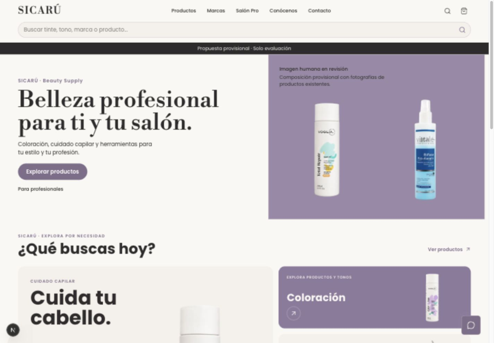

# SICARÚ · Evolución acotada del banner

## Estado verificado el 24 de noviembre de 2026

- Producción Vercel READY: main `1f4d8f2f661d8df056c0f559c4f948133e0a5052`, deployment `dpl_6pdQgoakj37wfCBeZLWEwxd72fv1`.
- PR #40, draft, no fusionado: `bf6a44695d26cfe6fa1671fa349fad13fea57136`, categorías aprobadas, Preview READY.
- PR #41, draft, no fusionado: `4f8747fcca21d4bebb7eb20e3710af80c7786392`, laboratorio Preview READY; retrato rechazado retirado.
- Esta propuesta parte exactamente del head del #41, que ya incluye #40. PR apilado sobre #41 para que el diff no repita las categorías. No fusionar ninguno como parte de esta tarea.
- Checkout original con numerosos cambios ajenos, conservado íntegro. Implementación aislada en `/private/tmp/sicaru-visual-20261124`, rama `codex/evolucion-visual-banner`.

## Investigación y límites de evidencia

Se consultaron las páginas oficiales actuales, no agregadores ni imitaciones:

| Referencia | Recurso observado en la página accesible | Aplicación propuesta |
| --- | --- | --- |
| [Sephora](https://www.sephora.com/) | Búsqueda visible y accesos por categorías y marcas | Conservar buscador y navegación multimarca; CTA inequívoco |
| [Gisou](https://gisou.com/) | Recorridos Hair, productos y rutinas alrededor del cuidado capilar | Brief futuro de cabello real, luz y textura; no copiar su universo de miel |
| [K18](https://www.k18hair.com/) | Separación entre comprar, resultados y educación; acceso a profesionales | Mensaje breve con propósito comercial y ruta profesional existente |
| [Sally Beauty](https://www.sallybeauty.com/) | Asesoría sobre color y acceso profesional | Sostener el recorrido de consulta y categoría profesional |
| [Rhode](https://www.rhodeskin.com/) | Colecciones y campañas por producto con accesos directos | Jerarquía concentrada y menor competencia entre mensajes |

La extracción web permite revisar estructura, textos y recorridos, pero no certifica las composiciones fotográficas ni sus métricas de conversión. La escala editorial, fotografía luminosa y fondos de campaña son hipótesis de dirección de arte a evaluar visualmente, no resultados de A/B tests de estos retailers. No se descargaron ni reutilizaron fotografías de estas marcas.

## Diagnóstico

El laboratorio anterior acumulaba una línea junto al nombre, un aro, dos gradientes y sombras. Esos elementos competían con el mensaje y no resolvían la falta de fotografía humana. El panel móvil tenía un mínimo de 370 px además del bloque de texto: desplazaba las categorías innecesariamente. Los productos pequeños al pie hacían que una composición prevista para un retrato pareciera vacía tras retirarlo.

## Dirección e implementación

Soft Professional Beauty + Retail Impact: marfil para lectura y morado localizado en el panel de imágenes, serif editorial existente para el mensaje, Poppins para interfaz y CTA. Sin modificar logo ni inventar identidad. El texto solicitado describe tanto consumidoras como profesionales. Un CTA principal; el enlace profesional secundario se conserva en tableta/escritorio y la categoría profesional permanece en móvil.

Se retiraron adornos y se sustituyó posicionamiento absoluto de productos por dos columnas con object-contain. Panel móvil compacto, imágenes completas y sin superposición con textos. Categorías #40 idénticas byte por byte. Marcas, destacados, WhatsApp, variantes y bloqueos de compra conservados.

La composición con productos es **provisional**. No demuestra todavía belleza mexicana, movimiento de cabello ni impacto emocional humano. No se atribuye origen mexicano a una modelo por su apariencia. Se requiere una sesión propia o fotografía licenciada con fuente, permiso comercial, consentimiento de modelo, archivo de resolución suficiente y aprobación visual. Ninguna fotografía humana heredada o conceptual se integró. No se generaron empaques ni se alteraron fotografías de producto.

## Comparación

| Antes (#41) | Esta propuesta |
| --- | --- |
| Panel alto preparado para retrato ausente | Panel provisional explícito y compacto |
| Aro, gradientes y sombras | Superficies planas con función de agrupación |
| Envases pequeños y posicionados al pie | Imágenes completas en celdas independientes |
| Texto secundario de 14 px | Descripción comercial y CTA de 16 px |
| Categorías desplazadas por el banner | Encabezado de categorías visible en móvil de 812–844 px de alto |

## Verificación

- Navegador integrado: revisión visual de 320, 375, 390, 768 y 1440 px; sin desbordamiento horizontal. Encabezado de categorías a y≈773, 680 y 656 px en los tres móviles. Buscador, titular y CTA visibles; ambas fotos cargadas y object-contain. En 320 px el titular ocupa cuatro líneas: revisar preferencia editorial con la propietaria.
- Meta robots comprobado: noindex, nofollow. Guarda existente limita ruta a desarrollo/Preview y modo catálogo. Noindex no sustituye autenticación. Vercel confirma SSO activo para all_except_custom_domains; esta tarea no cambia permisos del proyecto.
- Lint: cero errores, tres advertencias preexistentes (dos img de carrito y una variable de blog).
- Suite Node final: 115/115 aprobadas; se añade una regresión para excluir adornos rechazados y mantener aviso provisional.
- Build con backend inaccesible: aprobado. Repetido tras la última edición móvil. TypeScript sin errores.
- No se probaron Safari ni WebKit. No se ejecutó una medición controlada de Lighthouse, LCP, CLS ni conversión; la telemetría de desarrollo durante redimensionado no representa producción. No se puede afirmar mejora cuantificada de rendimiento.
- Backend local deliberadamente inaccesible: se verificó fallback de destacados; catálogo real y selección de variantes requieren QA del entorno conectado. No se escribieron datos ni se activaron pagos.
- Base remota Next 16.1.6, distinta al 16.4.3 del checkout original; no se mezcló una actualización de dependencias. Esa base no incluye docs locales de Next; se consultó la guía disponible en el checkout original (image). Build y TypeScript validan compatibilidad efectiva con la versión base.

## Límites y reversión

No aprobado para producción. La propietaria debe revisar expresamente el diseño y la fotografía final. Cerrar el PR o volver a la Preview anterior revierte esta exploración; la home de producción no cambia. No hubo cambios de precios, inventario, pagos, envíos, credenciales, base de datos ni arquitectura.

Captura local de escritorio (1440 px):

