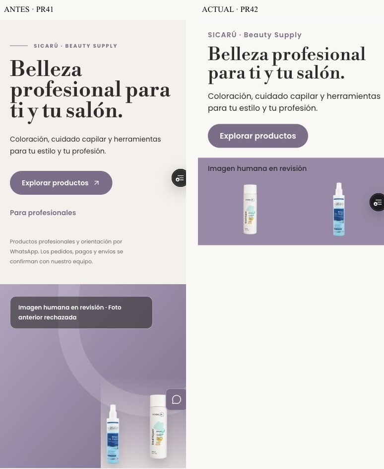
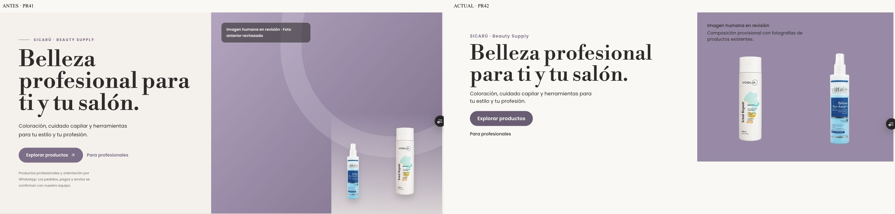
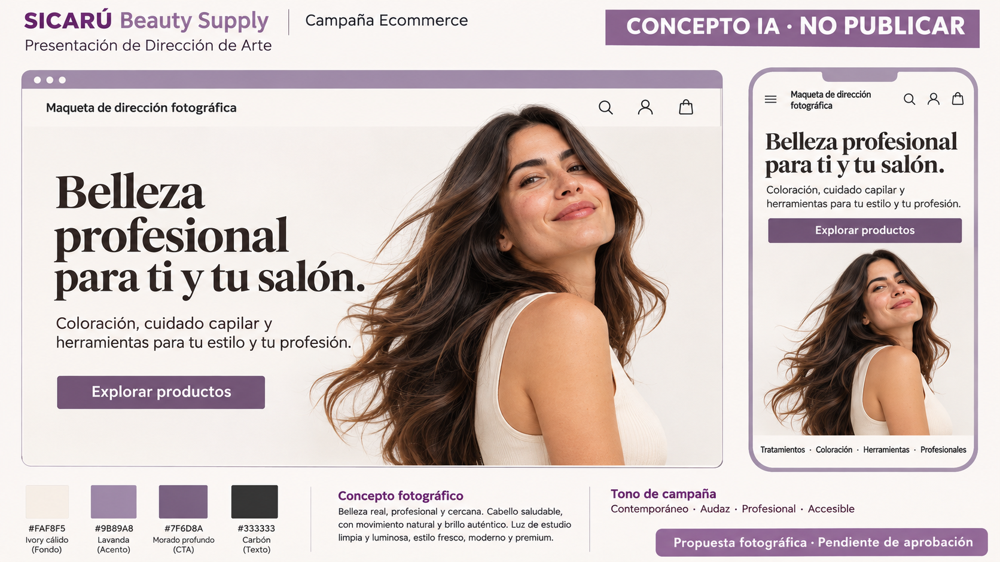
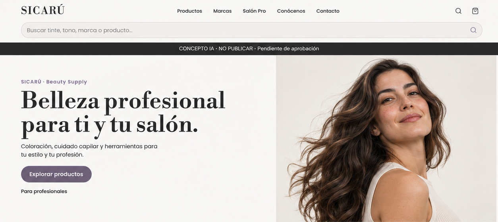

# PR #42 · Evidencia comparativa y dirección fotográfica

24 de noviembre de 2026. **Sin nuevos cambios de código. Sin merge ni publicación en producción.** Protección Vercel conservada, sin enlaces temporales ni cambios de permisos.

## Capturas de las Preview reales

Acceso directo mediante la sesión existente del navegador. No se utilizó la herramienta que crea enlaces compartibles. Capturas completas desde el encabezado hasta el pie, con altura de viewport de 1000 px; acercamientos recortados del archivo completo sin alterar el contenido. Se recorrió cada página para cargar sus imágenes antes de capturar. `mediciones.json` conserva geometría y resultados. La barra de desplazamiento ocupa 15 px dentro del viewport: el contenido de 390 px mide 375 px.

- Antes: PR #41, commit `4f8747fcca21d4bebb7eb20e3710af80c7786392`, [Preview protegida](https://sicaru-c8n93ndbz-sicaru-admins-projects.vercel.app/qa/banner-belleza-real).
- Actual: PR #42, commit `c2b01fe504c590815c425a89188b69b0abe5d18a`, [Preview protegida](https://sicaru-ne0dhfgzi-sicaru-admins-projects.vercel.app/qa/banner-belleza-real).

| Ancho | Página completa anterior | Página completa #42 | Banner anterior | Banner #42 | Comparación |
| --- | --- | --- | --- | --- | --- |
| 320 px | [Ver](anterior-320-completa.jpg) | [Ver](pr42-320-completa.jpg) | [Ver](anterior-320-banner.jpg) | [Ver](pr42-320-banner.jpg) | [Lado a lado](comparacion-320.jpg) |
| 375 px | [Ver](anterior-375-completa.jpg) | [Ver](pr42-375-completa.jpg) | [Ver](anterior-375-banner.jpg) | [Ver](pr42-375-banner.jpg) | [Lado a lado](comparacion-375.jpg) |
| 390 px | [Ver](anterior-390-completa.jpg) | [Ver](pr42-390-completa.jpg) | [Ver](anterior-390-banner.jpg) | [Ver](pr42-390-banner.jpg) | [Lado a lado](comparacion-390.jpg) |
| 768 px | [Ver](anterior-768-completa.jpg) | [Ver](pr42-768-completa.jpg) | [Ver](anterior-768-banner.jpg) | [Ver](pr42-768-banner.jpg) | [Lado a lado](comparacion-768.jpg) |
| 1440 px | [Ver](anterior-1440-completa.jpg) | [Ver](pr42-1440-completa.jpg) | [Ver](anterior-1440-banner.jpg) | [Ver](pr42-1440-banner.jpg) | [Lado a lado](comparacion-1440.jpg) |

## Qué mejora y qué falta

| Ancho | Alto anterior del banner | Alto #42 | Diferencia |
| --- | --- | --- | --- |
| 320 px | 969 px | 551 px | −418 px |
| 375 px | 945 px | 477 px | −467 px |
| 390 px | 903 px | 453 px | −450 px |
| 768 px | 934 px | 390 px | −544 px |
| 1440 px | 649 px | 480 px | −169 px |

Las capturas confirman simplificación y menor altura, no acreditan todavía impacto de campaña ni conversión. Sin overflow horizontal en los diez casos; noindex/nofollow en ambas Preview. Categorías aprobadas conservadas. Los controles flotantes de Vercel/WhatsApp son visibles en la evidencia original; no se borraron para embellecerla.

**Incidencia observada:** destacados muestra «No pudimos cargar esta selección» y marcas no presenta su colección de logos. Ocurre en ambos despliegues; esta evidencia no acredita catálogo conectado ni el flujo completo de variantes. No se cambió backend para esta revisión. Safari sigue pendiente.

## Dirección fotográfica · Cabello con vida

La fuerza debe venir del cabello y la expresión, no de adornos. Foto de campaña contemporánea, luminosa y nítida, con textura visible y movimiento físicamente creíble. Mujer adulta con presencia cercana y segura; evitar la pose rígida de salón, retoque plástico, brillo metálico y cabello convertido en una forma geométrica. La identidad mexicana se trabajará con casting y equipo locales documentados, sin deducir nacionalidad de rasgos físicos.

### Brief para una sesión real

- **Casting:** personas adultas mexicanas con consentimiento documentado, cabello con textura propia, diversidad de piel y tipos de cabello; seleccionar una protagonista para esta primera campaña y planear variaciones posteriores. El concepto no fija un único canon de belleza.
- **Acción:** giro suave de hombros y cabeza, ráfaga de disparos, ventilación leve fuera de cuadro; mechones con peso y continuidad, rostro despejado. Elegir una toma cuyo gesto y movimiento se sientan espontáneos.
- **Luz:** fuente amplia lateral/frontal, relleno suave y separación discreta para ver volumen; fondo marfil luminoso. Evitar neblina, contraluz lavado, filtros morados y sobreexposición que borre piel o cabello.
- **Estilismo:** prenda lisa marfil, maquillaje fresco, accesorios mínimos; sin empaques, herramientas ni marcas dentro de la fotografía principal. Productos reales permanecen en las categorías aprobadas para sostener el carácter multimarca.
- **Encuadre:** pecho/hombros y cabeza completos con margen alrededor de la silueta del cabello; aire en dirección del movimiento. Fotografiar variantes horizontales y verticales; no intentar resolver móvil recortando agresivamente una toma ancha.
- **Captura:** RAW de alta resolución, enfoque en ojos y fibra capilar; como punto de partida, lente de retrato 70–85 mm y velocidad suficiente para congelar el giro (p. ej. 1/500 s, ajustada con pruebas de luz). Retocar limpieza y balance, conservar piel y hebras naturales.
- **Entrega:** masters horizontales ≥3000 px de ancho y verticales ≥1800 px; derivados web AVIF/WebP evaluados a tamaño real. Definir presupuesto de peso tras comparar nitidez, no prometer rendimiento sin medirlo.
- **Derechos:** contrato/licencia para web comercial, consentimiento de modelo, territorios/plazo y permiso de recorte; registrar fotógrafo, fuente y aprobación de la propietaria antes de integrar.

### Integración propuesta antes de código

En escritorio, mantener el mensaje y CTA a la izquierda; fotografía protagonista a la derecha, fondo luminoso, sin texto sobre cabello o rostro. Morado en el botón y categorías, no aplicado como filtro fotográfico. En móvil, mensaje compacto y fotografía vertical específica con rostro/cabello completos; revisar juntos CTA, buscador y entrada a categorías en 320/375/390. La altura definitiva depende del encuadre aprobado: no reducirla a costa del cabello.

La maqueta sintética siguiente explora gesto, luz y relación texto/foto en escritorio y móvil. **No es captura de la web, no es fotografía documental ni material aprobado.** Su interfaz es ilustrativa: no adoptar nuevos iconos, formas de botón, tipografías, colores aproximados o el rótulo superior como identidad. La fuente autoritativa de logo/paleta/componentes continúa siendo el sitio existente.

### Criterios para revisión de la propietaria

1. ¿La foto produce atención y deseo sin competir con el CTA?
2. ¿Se ve contemporánea, cercana y profesional a tamaño móvil?
3. ¿Piel, brillo y movimiento resultan naturales, sin pérdida de detalle?
4. ¿Cabello y rostro están completos en ambas composiciones?
5. ¿La integración conserva SICARÚ y la lectura de las categorías multimarca?

La aprobación del concepto no sustituye autorización de uso de una fotografía final ni de publicación. Próximo paso dependiente: seleccionar dirección/encuadre y obtener material aprobado; después implementar y validar. No se realizan nuevos cambios de código en esta etapa.

## Banner propuesto en contexto de la interfaz

Acercamiento conceptual del banner con el mensaje, CTA y navegación de SICARÚ. Se limita al banner y no contiene empaques; los productos y categorías se evalúan con las capturas reales anteriores. La fotografía sigue siendo sintética y no representa una modelo contratada. Es una maqueta raster de dirección de arte, no una implementación funcional; no certifica medidas, fuentes exactas ni comportamiento responsive.

**Observación de arte:** esta exploración aporta piel y cabello con más presencia, pero aún hay que evaluar si la expresión y el movimiento son suficientemente frescos y enérgicos para SICARÚ. No se presenta como dirección aprobada. Para la sesión real se requiere mayor margen inferior de cabello y una toma vertical independiente, evitando forzar este encuadre en móvil.
