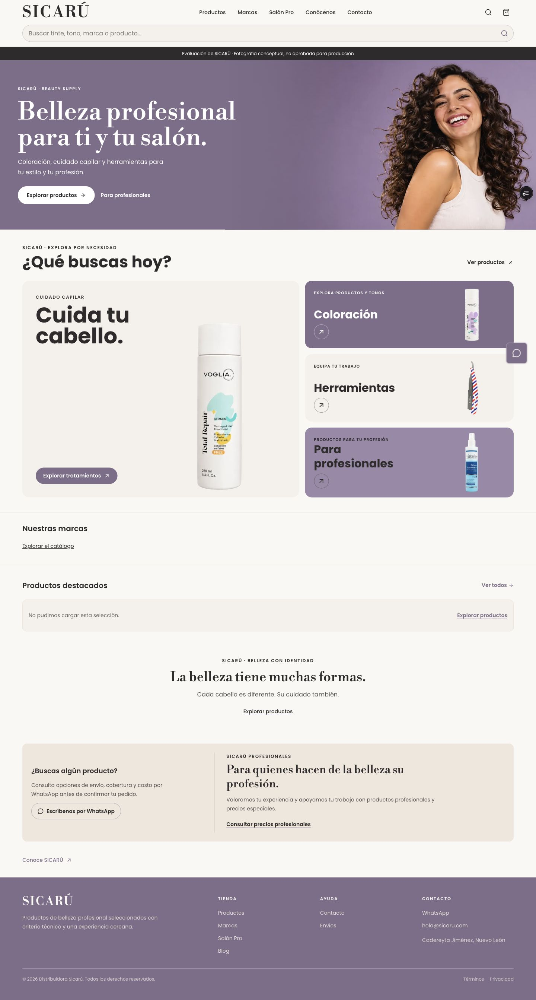

# SICARÚ · Portada integrada y contraste · PR #47

Solo Preview; PR en borrador. Sin merge ni publicación productiva.

## Alcance

Corrección de la [revisión de dirección visual](https://github.com/sicaru-admin/sicaru/pull/47#pullrequestreview-6051893091). Se mantienen encabezado, tamaños, distribución, fotografía, puntos focales, orden y fotografías de categorías. Los dos WebP siguen idénticos al manifiesto `../banner-candidato-assets.json`.

La ruta protegida `/qa/banner-candidato` ahora presenta el recorrido completo: banner candidato → categorías → marcas reales → productos destacados reales → identidad SICARÚ → consulta por WhatsApp → pie. Reutiliza los componentes comerciales existentes y su manejo de fallos. La ruta `/` conserva `HeroSection`; el candidato no se activa allí. El laboratorio conserva noindex y devuelve 404 fuera de Preview/desarrollo o del modo catálogo.

Código evaluado: `f1049504bf8c209aa364d2ae600c43bc60008dac`.

[Preview completa](https://sicaru-3c2bxxblv-sicaru-admins-projects.vercel.app/qa/banner-candidato) · deployment `dpl_CpEo3ucYuEy14NV9SBtiAutjFk3z`.

## Contraste

Ratios calculados con luminancia relativa sRGB de WCAG, sin redondear antes de comparar con 4.5:1. Se mide texto contra fondos sólidos; no es una auditoría integral de accesibilidad.

| Elemento | Antes | Corrección | Después |
| --- | --- | --- | --- |
| Coloración, texto pequeño | Marfil #FAF8F5 / #8E7A9E, 3.65:1 antes de opacidad | Blanco #FFFFFF / morado oficial #7F6D8A, sin transparencia | 4.71184:1 |
| Profesionales, descripción | #2E2B2B / #9B89A8, 4.37:1 antes de opacidad | #292529 / #9B89A8, sin transparencia | 4.70003:1 |
| Botón Explorar tratamientos | #FAF8F5 / #7F6D8A, 4.44490:1 | Blanco #FFFFFF / mismo morado | 4.71184:1 |
| Textos pequeños de categorías sobre marfil | Morado #7F6D8A / #FAF8F5, 4.44490:1 | Grafito de marca #2E2B2B sobre el fondo existente | Mayor de 12:1 |

Coloración usa un morado ya existente en la identidad; no cambia la distribución de la tarjeta. La descripción de profesionales usa el ajuste mínimo propuesto en el comentario. Los títulos grandes de profesionales conservan su color. Se elimina `opacity-90` en las descripciones. Fuente metodológica: [WCAG 2.2, contraste mínimo](https://www.w3.org/WAI/WCAG22/Understanding/contrast-minimum.html).

## Capturas completas

| Ancho | Evidencia |
| --- | --- |
| 320 px | [Página completa](pagina-completa-320.jpg) |
| 390 px | [Página completa](pagina-completa-390.jpg) |
| 768 px | [Página completa](pagina-completa-768.jpg) |
| 1440 px | [Página completa](pagina-completa-1440.jpg) |

Capturas originales del navegador integrado, viewport de 1000 px de alto, sin retoque, recorte ni reescalado. Se recorre la página para cargar imágenes diferidas y se vuelve al inicio. Las secciones comerciales muestran el estado real de esta Preview, incluidos sus mensajes de recuperación. Mediciones en `responsive.json`; integridad en `integridad-capturas.json`.

## Pruebas

- `npm run build`: correcto.
- `npx tsc --noEmit`: correcto.
- `npm run lint`: 0 errores, 3 advertencias previas (dos imágenes de carrito y variable `_` en blog).
- `node --experimental-vm-modules --test tests/*.test.mjs`: 120/120 correctas. Incluye integridad WebP, contraste, restricción de laboratorio, portada productiva sin candidato y guardas comerciales.
- [GitHub Actions #183](https://github.com/sicaru-admin/sicaru/actions/runs/45548466638): **SUCCESS** (job quality y todos sus pasos); incluye pruebas de navegador con backend controlado para móvil, carrito informativo y checkout deshabilitado.

Los hashes protegidos se actualizan exclusivamente para `CategoriesGrid.tsx`, tras revisar los cambios de contraste. No se debilitan las guardas comerciales ni se cambian otras huellas.

## Safari y Medusa

Safari está instalado. Se volvió a intentar el acceso nativo y el sistema indicó que los permisos de Computer Use no están concedidos. **Safari no probado**; las capturas no corresponden a Safari ni a una emulación WebKit. No se cambiaron permisos ni se eludió la restricción.

La consulta de metadatos de Vercel, sin descifrar valores, confirma que no hay una clave publicable Medusa aplicable a `release/home-categorias-envios-logo-preview-20261124`. La autorización previa de #44 no cubre esta rama. No se amplió su ámbito ni se modificaron variables. Por ello, integrar los componentes no garantiza datos disponibles: verificar la carga real de marcas/productos y las fichas/variantes/WhatsApp por SKU queda bloqueado mientras la Preview carezca de esa configuración autorizada. No se insertan datos simulados ni se presentan las pruebas con backend controlado como validación del catálogo real.

Precios, inventario, credenciales, pagos y configuración de Medusa intactos. La composición puede evaluarse, pero la validación comercial completa y Safari siguen pendientes. No apto para publicación sin resolver esos límites y recibir aprobación final.

## Resultado de la revisión en navegador

- 320 × 4000, 390 × 3869, 768 × 2927 y 1440 × 2685 px: página completa sin overflow horizontal; todas las imágenes renderizadas cargadas. Rostro visible, cabello y puntos focales conservados. Los rizos periféricos continúan próximos al borde en algunos anchos, sin nuevo recorte.
- El logo conserva tamaño y posición; no se observan colisiones con menú, iconos o buscador. La transición al marfil y la jerarquía de «¿Qué buscas hoy?» se mantienen.
- Clic real en «Explorar productos»: abre `/productos`, H1 «Encuentra tu próximo favorito»; catálogo sin datos en esta Preview. «Para profesionales»: abre `/salon-pro`, H1 «Un aliado para tu trabajo». El enlace del banner sigue oculto en móvil según composición aceptada; la tarjeta de profesionales continúa disponible.
- Búsqueda «Voglia»: el formulario abre `/productos?q=Voglia` y conserva el término; devuelve cero resultados. Esto valida navegación y estado vacío, no la búsqueda contra el catálogo real.
- Las tres rutas de categorías abren su recuperación «Esta selección no está disponible por ahora»; no muestran una página 404. El contenido comercial sigue pendiente por Medusa.
- Marcas muestra «Explorar el catálogo»; destacados, «No pudimos cargar esta selección». No hay productos ficticios. WhatsApp mantiene `https://wa.me/528281136652`; enlaces inspeccionados sin enviar mensajes. No se pudo verificar contexto de variante/SKU por ausencia de productos reales.
- Sin errores/advertencias de consola capturados en la pestaña de revisión. Esto no certifica ausencia de errores del backend.

