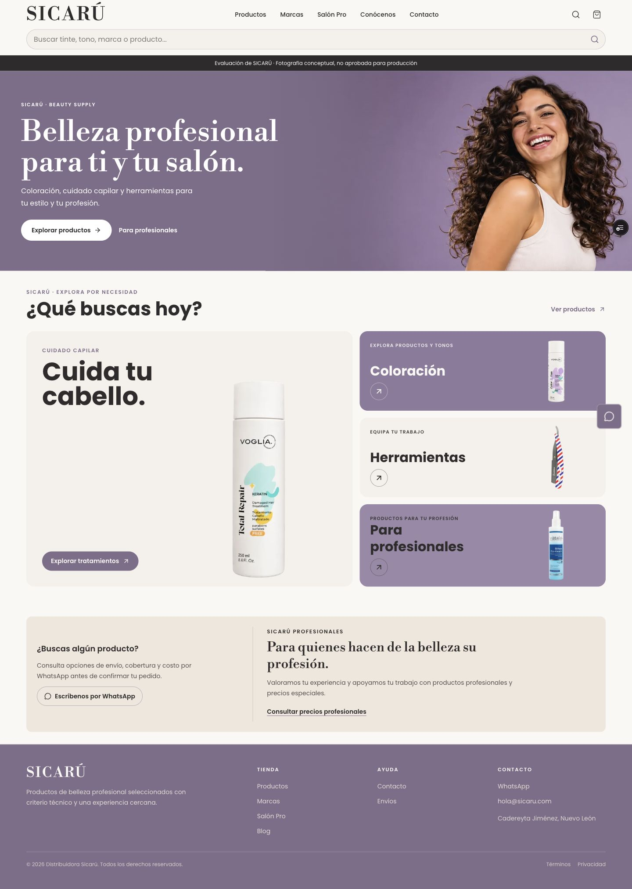

# SICARÚ · Revisión visual del PR #47

**Solo Preview. PR en borrador, sin merge ni publicación en producción.** Esta entrega adjunta evidencia y evaluación; no cambia el banner, fotografías, portada, logo, componentes ni configuración.

## Capturas completas originales

Las cuatro capturas son las ya generadas desde el deployment real del commit **d22ec3adc0bbb44c5fb27f5bf681f1d1d9854a50**, no nuevas maquetas ni capturas de producción. Se copiaron byte por byte, sin recorte, retoque ni reescalado; SHA-256 en `integridad-capturas.json`.

[Preview evaluada: /qa/banner-candidato](https://sicaru-3mz70g4os-sicaru-admins-projects.vercel.app/qa/banner-candidato) · Deployment `dpl_5qXRRdKrk5DCpzpc2KkmzHGpaNGm`.

| Viewport | Página completa | Tamaño de la captura |
| --- | --- | --- |
| 320 px | [Abrir captura](pagina-completa-320.jpg) | 320 × 3318 px |
| 390 px | [Abrir captura](pagina-completa-390.jpg) | 390 × 3211 px |
| 768 px | [Abrir captura](pagina-completa-768.jpg) | 768 × 2266 px |
| 1440 px | [Abrir captura](pagina-completa-1440.jpg) | 1440 × 2024 px |

La altura del viewport al capturar fue de 1000 px; las imágenes incluyen la página completa hasta el pie. Se recorrió la página para cargar las fotografías diferidas y se volvió al inicio. Los controles flotantes de Vercel y WhatsApp se conservan tal como aparecieron: no se eliminaron para embellecer la evidencia.

## Evaluación

### Presencia del logo y encabezado

El nombre SICARÚ se lee con claridad en los cuatro tamaños y queda separado de los iconos. El buscador conserva una fila propia y no se observan colisiones ni overflow. La medición actual del mismo deployment, registrada en `controles-responsive.json`, es:

| Viewport | Marca visible (aprox.) | Encabezado con buscador |
| --- | --- | --- |
| 320 / 390 | 136.6 × 31.7 px | 115 px |
| 768 | 148.3 × 34.4 px | 123 px |
| 1440 | 182.8 × 42.4 px | 125.4 px |

Mi evaluación es que el tamaño actual tiene presencia y permanece equilibrado con el menú y el buscador. **Límite de identidad:** se está evaluando la representación tipográfica existente de `BrandWordmark`, ajustada previamente en #46, no una implementación del archivo gráfico oficial completo. Este trabajo no cambia esa decisión ni certifica como aprobado el logo gráfico pendiente.

### Rostro y cabello

- En móvil se selecciona el original `sicaru-hero-mobile.webp` (1174 × 887); en tableta/escritorio, `sicaru-hero-desktop.webp` (1774 × 887), servido a través del optimizador de Next.
- El rostro queda visible y libre de texto. En móvil la fotografía va debajo del mensaje; en tableta/escritorio el mensaje ocupa la izquierda y la fotografía la derecha.
- Se conservan exactamente los puntos focales existentes: móvil centrado, 768 px al 86% y 1440 px al 60%. No se cambió composición ni CSS.
- **Punto de revisión expresa:** algunos rizos periféricos quedan próximos al borde derecho o salen de cuadro según el ancho. No equivale a corte del rostro, pero conviene que la propietaria confirme ese margen visual en las cuatro capturas. No se reconstruyó ni retocó cabello.
- No se ven los títulos de la antigua lámina conceptual incrustados en la foto. El aviso externo del laboratorio se mantiene porque la ruta es de evaluación.

### Transición a categorías

El paso del morado del banner al marfil diferencia campaña y navegación. El bloque «¿Qué buscas hoy?» se reconoce como siguiente acción y las fotografías de categorías mantienen su protagonismo, sin intersección con la imagen humana.

La sección de categorías comienza aproximadamente en y=816 a 320 px, y=757 a 390 px, y=614 a 768 px y y=616 a 1440 px. Son posiciones medidas desde el inicio, con el aviso de evaluación incluido. En pantallas móviles de menor altura será necesario desplazarse: las capturas completas no afirman que todo el recorrido quepa en la primera pantalla.

No se observan desbordamientos horizontales en los cuatro viewports. En 320 px el titular y los textos de categorías ocupan más líneas; siguen legibles. El control flotante WhatsApp puede aparecer sobre el área visual de categorías: no se detecta que tape sus CTA principales en estas capturas, pero se conserva visible para que pueda evaluarse.

### Botones y enlaces

Comprobados en el deployment evaluado mediante la sesión existente, sin crear enlaces temporales ni enviar mensajes:

- **Explorar productos:** visible en los cuatro tamaños, área de 48 px de alto. Clic real abre `/productos`, con H1 «Encuentra tu próximo favorito».
- **Para profesionales:** el enlace del hero es visible a partir de tableta (44 px de alto). Clic real abre `/salon-pro`, con H1 «Un aliado para tu trabajo». En móvil permanece oculto por la composición existente; el acceso continúa disponible en la categoría «Para profesionales» y en el bloque inferior. Se documenta, sin modificarlo.
- **WhatsApp:** los enlaces inspeccionados mantienen `https://wa.me/528281136652`; no se pulsaron ni se enviaron consultas.
- Las rutas de categorías se conservan. Esta entrega no sustituye las pruebas comerciales del catálogo ni afirma que el backend de #47 esté validado por navegar a una página; el laboratorio omite marcas/destacados y no se amplió el ámbito de la clave Medusa.

Los estilos de foco se conservan en código. No se declara un recorrido exhaustivo de teclado ni una auditoría completa de accesibilidad en esta entrega.

## Safari

**Safari está instalado** en `/Applications/Safari.app`. Se intentó abrirlo con la herramienta de control nativo; el sistema respondió que no están concedidos los permisos de Computer Use. Por tanto, la revisión de Safari **no se pudo ejecutar** y sigue pendiente. No se cambiaron permisos del sistema ni se utilizó otro mecanismo para eludir ese bloqueo. Las capturas corresponden al navegador integrado, no a Safari ni a una emulación WebKit.

## Integridad y límites

Los originales WebP continúan coincidiendo con el manifiesto de assets; no se copiaron versiones modificadas ni sustitutas. Código de aplicación y tests sin cambios respecto a d22ec3a. El build, TypeScript, 119 pruebas y [CI #181](https://github.com/sicaru-admin/sicaru/actions/runs/45544955548) aprobados corresponden a ese código; no se repiten checks de aplicación para una adición exclusivamente documental.

La fotografía continúa conceptual, sin aprobación de producción. La home no importa ni activa `CampaignHeroCandidate`; no hubo fusiones ni cambios de precios, inventario, credenciales, pagos o Medusa. La aprobación visual final sigue correspondiendo a la propietaria.

## Vista previa de escritorio

